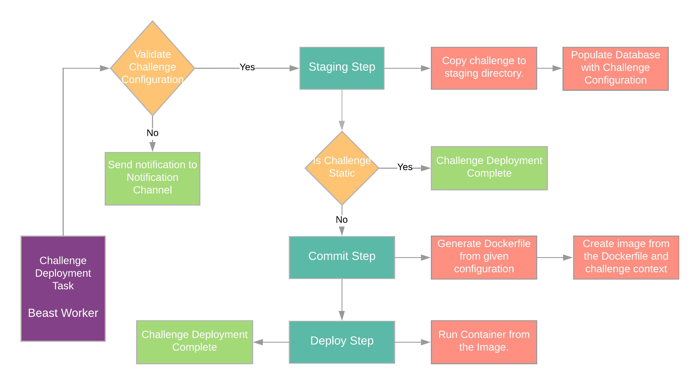

# Architecture

Beast exposes a Gin HTTP API and a Cobra CLI. Both use the same challenge manager. PostgreSQL holds users, challenges, submissions, scoring, and deployment records. Redis holds cache entries, active instances, expiration markers, and port reservations.

## API groups

| Prefix | Purpose |
| --- | --- |
| `/auth` | Registration, password login, OTP verification, and recovery. |
| `/api/manage` | Deployment, lifecycle actions, verification, uploads, and logs. |
| `/api/info`, `/api/status` | Challenge details, public assets, hints, submissions, rankings, and deployment status. |
| `/api/check`, `/api/submit` | Run an instance checker or submit a flag. |
| `/api/instances` | Create, inspect, extend, and delete a user's instances. |
| `/api/notification` | List, manage, and stream competition announcements. |
| `/api/config`, `/api/remote`, `/api/admin` | Administrator operations for configuration, Git, competition data, and instances. |

## Deployment pipeline

The manager validates the challenge, stages its configuration and build context, builds Docker images or prepares a Compose project, and deploys shared workloads. Static challenges stage assets without starting a challenge container. Instanced challenges prepare their artifacts during deployment and start the workload when a user requests an instance.

The API queues deployment actions and returns an acknowledgment. Workers run the pipeline and update status. The CLI waits for the result of a normal challenge action. Beast talks to the local Docker daemon or executes Docker commands on a configured remote host over SSH.

